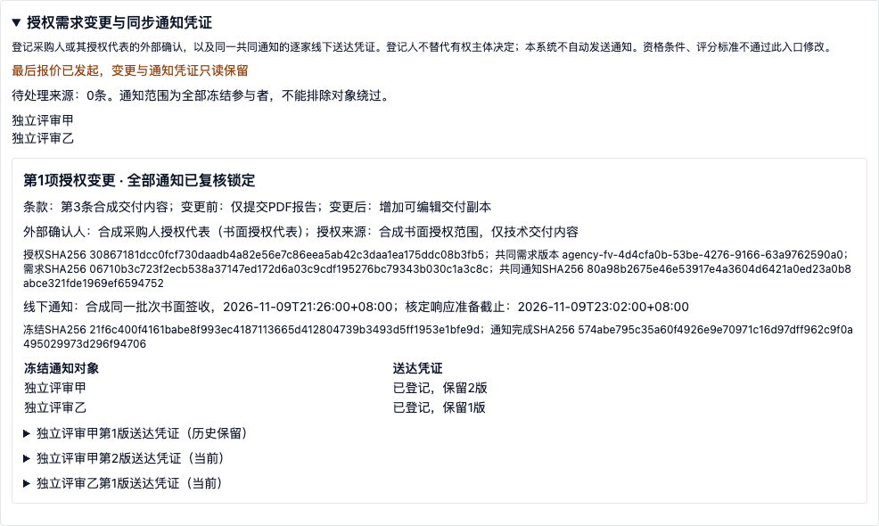
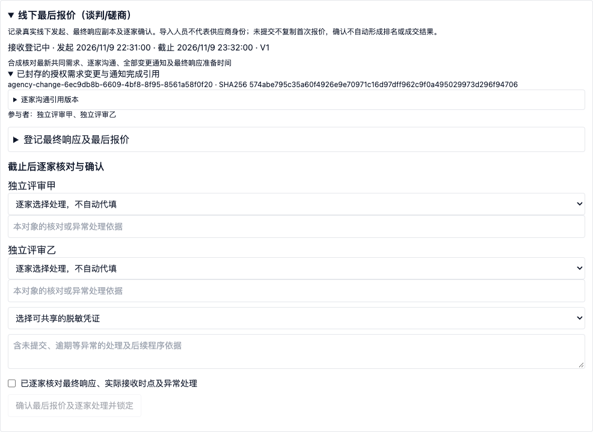

# P3授权需求变更与同步线下通知凭证交付说明

2026年11月9日，完成P3第10项，在24Bid隔离工作区实现并验证；未部署生产。沿用一期半流程边界：工作人员登记采购人或其授权代表的外部确认，以及实际线下通知凭证。全流程电子标放在第二期，接入现有产品或重新开发尚未决定，见[阶段边界](../../../docs/p0/04_实施计划.md)。

## 交付行为

竞争性谈判、竞争性磋商任务启用逐家沟通后，已确认的“需要授权需求变更”记录可作为来源。系统一次收集全部未处理来源，冻结其ID、对象和哈希。未确认草稿必须先处理，没有来源不能凭空登记。只允许同时存在一项待通知核对的变更，历次完成记录形成连续追加链；新沟通再次提出变更时，旧确认不能解除新阻断。

工作人员填写条款定位、变更前后共同内容、调整类型、外部有权确认人的姓名身份与授权范围，引用已封存的脱敏确认凭证、共同最终需求和共同通知。人工核对允许范围、共同内容脱敏及响应准备时间后，冻结全部信息和材料的实际字节哈希。共同内容支持多段输入，不带入逐家私有回应。授权不得早于来源沟通结束，实际通知不得早于授权或晚于当前时间，响应准备截止必须晚于通知。

本入口登记技术要求、服务要求或合同条款的外部确认，不改写冻结的资格条件、评分标准、人员或采购方式；其他类型由服务端拒绝。登记账号只承担凭证录入及复核职责，不能把自己的内部操作当作采购人批准。系统不自动识别条款是否合法、凭证是否真实授权或内容是否完全对应；这些仍需业务人员核对，发生规则冲突须通过异常流程暂停并重新组织。

## 全部对象通知及追加更正

通知范围固定为逐家计划中的全部冻结参与者，不接受选择性排除。每个对象登记实际接收时间、接收人及身份来源、送达凭证、对照同一冻结通知和需求的核对说明。送达须在统一批次通知发出后、当前时间前且早于响应准备截止。这里的同步通知是同一批次、同一共同内容的线下证据管理，不宣称自动发送或物理上同时送达。

送达凭证为不可变记录。统一复核前可明确引用前版并填写更正依据，追加新版而保留原始事实；版本或前序不一致时拒绝。界面未保存的本对象事实会锁定对象切换，保存或显式放弃后才允许切换，不把内容带入其他对象。后台轮次暂停时保留未保存内容并禁用操作。

全部冻结对象均有凭证后，仍须人工引用统一复核材料并确认，才形成通知完成快照，封存每个对象当前有效凭证的ID和哈希。部分送达、最后报价排除某个对象、追加“无变更”沟通、沿用旧指纹均不能解除阻断。锁定后不提供覆盖或删除；发现错误按异常程序处置。

## 最后报价、历史及权限

最后报价必须引用最新已完成通知核对的共同最终需求版本；实际发起不得早于全部通知送达，截止不得早于任何已核定的响应准备截止。每次后续变更要求追加新的共同需求版本，重新登记全部对象送达并复核。最后报价封存所有已完成变更的ID及通知完成哈希，并继续封存逐家沟通引用；最后报价发起后，变更和通知写入口全部只读保护。

全链路复用项目数据范围、冻结组织人员或组长职责、基线检查及轮次控制。新增权限为`buyer:agency:evaluation:change:read`和`buyer:agency:evaluation:change:register`。普通独立评审成员即使有广泛权限也不能查看组织者变更及送达核对信息。通用事件只保存状态和指纹，不复制私有沟通或接收人说明。暂停阻断登记、追加更正及统一复核，独立恢复后旧确认指纹仍失效。

V283新增两张追加台账及最后报价引用列，没有改写V282或补造历史授权。历史任务仍保留显式线下路径，不能在最后报价后倒补依据；价格计算兼容新增空列，避免历史有效快照因结构变化失效。

## 验证结果与证据

| 项目 | 结果 |
| --- | --- |
| 后端全量 | 1339项通过，失败、错误、跳过均为0 |
| 前端全量 | 185个文件、859项通过 |
| 最终专项 | 后端95项、前端10项通过 |
| 生产构建 | TypeScript及Vite通过 |
| 实际HTTP | 6组通过：范围和材料校验、不可变授权、逐家送达及更正、暂停恢复和统一复核、连续变更、最后报价封存 |
| 浏览器 | 5组通过，页面异常0；覆盖实际表单操作、未保存隔离、历史更正、锁定及权限 |
| 前项回归 | 材料开启14、独立评审15、评审准备14、基础9、初次报价7、最后报价9、价格10、汇总7、异常9、逐家沟通7组通过 |
| 数据库及接口 | 隔离库V283成功；提取6项操作、4个路径、23个Schema |

全量测试后，后端复用了进度查询中的变更核对结果，前端将前后条款改为多段输入；完成上述最终专项及最终构建。实际HTTP和浏览器使用合成磋商数据；谈判复用方式及过程规则，不将其视作六方式真实业务验收。真实授权文件、通知样例及Office实际模板往返仍需后续业务验收。

[机器汇总](evidence/p3-requirement-change-validation-summary.json)、[后端全量](evidence/p3-requirement-change-backend-tests.log)、[前端全量](evidence/p3-requirement-change-frontend-tests.log)、[后端最终专项](evidence/p3-requirement-change-final-targeted-backend.log)、[前端最终专项](evidence/p3-requirement-change-final-targeted-ui.log)、[构建](evidence/p3-requirement-change-build.log)、[HTTP结果](evidence/p3-requirement-change-http.json)、[浏览器结果](evidence/p3-requirement-change-browser.json)、[前项回归链](evidence/p3-requirement-change-regression-chain.log)、[逐家过程回归](evidence/p3-requirement-change-discussion-regression.json)、[迁移](evidence/p3-requirement-change-migration.json)。





## 代码、契约与复验

[服务及守卫](../../backend-java/src/main/java/com/procurement/agency/application/AgencyRequirementChangeService.java)、[时间及范围规则](../../backend-java/src/main/java/com/procurement/agency/application/AgencyRequirementChangePolicy.java)、[API](../../backend-java/src/main/java/com/procurement/agency/api/AgencyRequirementChangeController.java)、[V283](../../backend-java/src/main/resources/db/migration/V283__agency_requirement_changes.sql)、[前端](../../apps/tenant-portal/src/features/agency/agency-requirement-change-panel.tsx)、[OpenAPI契约](p3-requirement-change-openapi.json)。

在implementation目录、独立后端18080和前端15173就绪后：

```sh
python3 scripts/p3-requirement-change-run-smoke.py
node scripts/p3-requirement-change-browser.mjs
```

包装脚本按顺序重建合成租户的前项回归、逐家沟通回归及本次接口场景，明确使用18080。浏览器依赖本机Chrome及现有Playwright运行时。脚本只面向`agency-assessment-*`合成数据；不删除历史或提高轮次上限。逐家过程迁移回归依赖迁移前保留的私有合成会话，详见[前项交付](P3逐家沟通交付说明.md)。登录会话及运行密钥位于被忽略的`.p0`目录，不属于证据，不入库。

## 后续任务

继续补齐六种采购方式的专有流程，先推进最终响应复核及方式分支约束，再衔接受控推荐和报告。邀请依据、询价一次报价边界、单一来源协商依据、各方式推荐等仍需按需求逐项完成；本次不宣称P3或六方式验收全部完成。后续仍为一期半流程研发，不依赖二期电子标选型。
