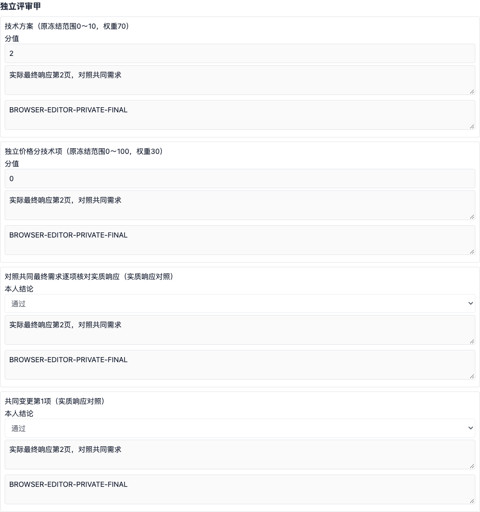
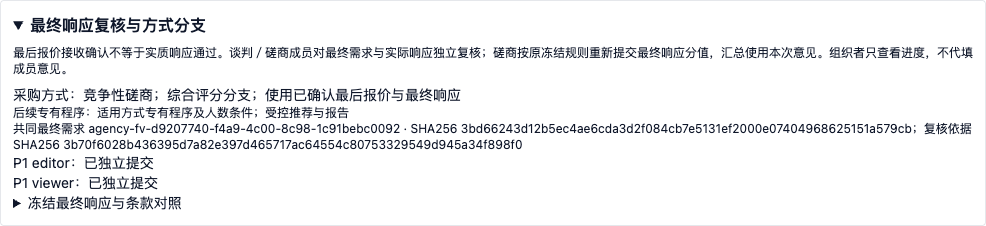

# P3最终响应独立复核与方式分支交付说明

2026年11月9日，P3第11项已实现并完成本轮技术验收。基于24Bid隔离工作区开发，未部署生产。一期仍采用线下组织、工作人员登记和内部评审；全流程电子标在第二期，接入现有产品或重新开发待用户决定，见[阶段边界](../../../docs/p0/04_实施计划.md)。

## 最终响应与接收确认分开

最后报价的接收确认只确认材料、金额、接收时点和异常处理，不表示实质响应通过。新确认的谈判／磋商任务必须建立最终响应复核，不能直接把初次响应意见当作最终意见计算。

组织人员在截止并确认材料后，人工核对并冻结：共同最终需求版本及实际字节哈希、已完成通知的授权变更、每个有效最终响应的接收记录及精确文件版本、全部冻结评审成员，以及原有技术商务规则。没有有效最终响应时不补造任务，也不复制首次响应或报价。缺失、排除和逾期处理仍保留在原最后报价台账中。

复核清单包含共同最终需求全文的实质响应核对、原冻结符合性条款对照，以及每项已授权并通知的共同变更。条款保留原文定位、内容和来源指纹。原资格条件和评分标准不在此入口变更；有冲突须暂停并按适用程序处理。原技术商务评分范围、权重及舍入规则保持冻结，磋商成员针对实际最终响应重新提交对应分值。

承担任务的人员是原冻结名单中具有`review_member`职责的全部成员，组织人员不能事后挑选少数成员或用管理员身份代填。未配置该职责时阻止启用，不能自动把组长、采购人代表或监督人员当作评审成员。复核最多3000个对象与条目组合，超过时明确阻止，不截断或漏记。

## 本人独立意见与材料访问

每名成员从空白草稿开始，只能读取、保存和独立提交本人的意见。支持不完整草稿；提交前检查全部对象、全部职责项、分值范围、明确结论、原文依据和本人意见。客户端传入其他人员身份不改变登录身份。提交时重新核对最终响应实际字节及封存哈希，并引用脱敏复核凭证。

提交后形成绑定复核计划、本人身份、材料依据和全部意见的不可变快照。组织人员及通用进度只展示成员是否完成，不返回他人草稿或意见。系统不从初次响应、另一成员或AI意见推填；回归脚本复用固定合成数值只是技术样例，产品没有该回填逻辑。

新增的成员下载权限只对本任务已确认有效、并已冻结进入复核计划的精确最终响应版本开放；计划启用前、未确认材料及不承担职责的人员仍被阻止。既有文件下载权限、项目数据范围和保密权限继续执行。普通评审成员不因此获得材料上传、组织确认或他人改分能力。

前端入口为“评审准备 → 独立评审任务 → 最终响应复核与方式分支”。暂停后保留本地和服务端草稿并禁用修改；恢复后必须重新核对依据指纹。服务端草稿版本变化时保留本地内容，需显式绑定新版本或放弃本地修改。另一窗口已提交时，界面展示实际提交快照，不把本地未提交内容显示为已锁定事实。

## 计算与汇总衔接

最终响应复核未完成，或者存在成员结论分歧，都会阻断后续价格与汇总。分歧不自动多数表决、不自动改写，也不能仅通过排除对象绕过。成员均填未通过的对象不能纳入价格计算；排除仍须明确处理依据并符合原有数量守卫，不自动形成整体资格、排名、推荐或成交结论。

已启用最终复核的任务，以本次最终响应意见作为评审计分前置，不要求为了计算而重复提交不再计分的初次评分。前置资格与符合性阶段的顺序、职责及处理依据继续执行。

磋商综合评分中的成员计分来源改为最终响应提交记录，保留各成员记录ID和哈希；不读取旧初次响应分值。客观价格分继续使用独立价格计算作为唯一来源，不重复叠加成员手填价格分。价格依据指纹纳入最终复核计划及全部成员提交状态，汇总间接绑定同一依据。

本轮提交后不开放直接覆盖。最终响应意见的授权更正闭环列为下一项；当前发现错误须暂停并按异常程序另行组织，不能在报告或后台改数。本次没有把更正功能标为已完成。

## 六方式分支约束

统一方式矩阵由规则冻结、价格校验和最终复核共同使用，方法与采购方式不匹配时拒绝。

| 采购方式 | 允许的评审分支 | 本次约束 |
| --- | --- | --- |
| 公开招标、邀请招标 | 综合评分或最低评标价 | 不开放谈判／磋商最后报价及最终响应再次议价入口 |
| 竞争性谈判 | 谈判价格分支 | 读取已确认最后报价，最终实质响应核对不套技术商务综合评分 |
| 竞争性磋商 | 综合评分 | 读取已确认最后报价及绑定最终响应的新成员意见，保持原评分标准 |
| 询价 | 价格比较 | 不开放综合评分或谈判／磋商最后报价入口；一次报价有效性专有程序继续补齐 |
| 单一来源 | 专业协商分支 | 不进行竞争性价格排名或综合评分；专业协商台账和依据继续补齐 |

这是一套共享分支保护，不代表邀请依据、询价一次报价有效性、单一来源协商、各方式人数条件、推荐和报告已经完成，也不把单元矩阵验证当作六种方式真实业务演练。

## 历史兼容和权限配置

V284只为迁移前已经确认的最后报价任务标记显式历史线下复核路径，不补造个人意见。迁移前尚未确认和所有新任务须进入新复核。历史任务可以在尚无价格计算时主动启用；已有价格计算后不允许倒改路径。历史模式不额外改变价格依据，验证了迁移前已存在且有效的价格快照仍有效；原来已经失效的历史不会被重新标为有效。

新增权限为`buyer:agency:evaluation:final-response:read`、`buyer:agency:evaluation:final-response:organize`、`buyer:agency:evaluation:final-response:review`。成员还需既有的评审保密、项目及文件读取权限；下载需要响应材料读取和文件下载权限。只具有项目只读成员身份也可在明确冻结职责和个人复核权限下办理本人任务，不要求通用项目编辑权限。

## 验证与证据

| 验证 | 结果 |
| --- | --- |
| 后端全量 | 1347项通过，失败、错误、跳过均为0 |
| 前端全量 | 186个文件、863项通过 |
| 最终专项 | 后端113项、前端4项通过 |
| 生产构建 | TypeScript及Vite通过 |
| 实际HTTP | 7组通过；包含授权变更条款、意见隔离、暂停、分歧、历史兼容，以及不重复初次评分的路径 |
| 浏览器 | 5组通过，页面异常0；包含空白草稿续写、成员隔离、精确字节下载、独立锁定及组织进度 |
| 数据库及接口 | 隔离库V284成功；5项操作、4个路径、20个Schema |

前项实际回归通过：材料开启14、独立评审15、评审准备14、基础9、初次报价7、最后报价9、价格10、汇总7、异常9、逐家沟通7、授权变更6组。差异分值用例将初次意见对应的79.00／52.00替换为最终意见对应的51.00／45.00，核对了新提交记录的精确引用；也验证了初次评分仍为空白时，完成最终评分即可进入计算。

全量测试后完善了精确附件引用、读取冻结依据的校验及计分前置切换，完成上述最终专项；最终实际链路和浏览器结果以归档机器证据为准。测试使用合成磋商数据，方式矩阵有独立单元验证；真实采购文件、实际授权及送达材料、真实Office模板往返、六方式完整业务演练和生产容量验收仍保留。

[验收汇总](evidence/p3-final-response-validation-summary.json)、[后端全量](evidence/p3-final-response-backend-tests.log)、[前端全量](evidence/p3-final-response-frontend-tests.log)、[后端最终专项](evidence/p3-final-response-final-targeted-backend.log)、[前端最终专项](evidence/p3-final-response-final-targeted-ui.log)、[构建](evidence/p3-final-response-build.log)、[HTTP结果](evidence/p3-final-response-http.json)、[浏览器结果](evidence/p3-final-response-browser.json)、[完整回归链](evidence/p3-final-response-regression-chain.log)、[迁移](evidence/p3-final-response-migration.json)。





## 代码与复验

[复核服务](../../backend-java/src/main/java/com/procurement/agency/application/AgencyFinalResponseService.java)、[方式矩阵](../../backend-java/src/main/java/com/procurement/agency/application/AgencyMethodPolicy.java)、[材料访问](../../backend-java/src/main/java/com/procurement/agency/application/AgencyFinalQuoteAccess.java)、[价格依据](../../backend-java/src/main/java/com/procurement/agency/application/AgencyPriceService.java)、[汇总来源](../../backend-java/src/main/java/com/procurement/agency/application/AgencyTotalService.java)、[V284](../../backend-java/src/main/resources/db/migration/V284__agency_final_response_reviews.sql)、[前端](../../apps/tenant-portal/src/features/agency/agency-final-response-panel.tsx)、[OpenAPI](p3-final-response-openapi.json)。

在implementation目录、隔离后端18080及前端15173就绪后：

```sh
python3 scripts/p3-final-response-run-smoke.py
node scripts/p3-final-response-browser.mjs
```

包装脚本顺序执行前项完整合成回归和本次接口验收，生成新合成租户以避免累计触发轮次技术上限，不删除历史。历史兼容检查依赖被忽略的私有迁移前会话`.p0/p3-final-response-legacy-session.json`，其中保留了真正早于V284的有效价格记录ID及迁移时间；另依赖前项迁移回归会话，见[前项交付](P3授权需求变更交付说明.md)。这些会话和运行密钥不属于交付证据，不入库。浏览器依赖本机Chrome和既有Playwright运行时。

下一项细化最终响应意见的授权更正闭环，再继续邀请、询价和单一来源等专有程序，以及受控推荐与报告。全流程电子标仍在第二期。
