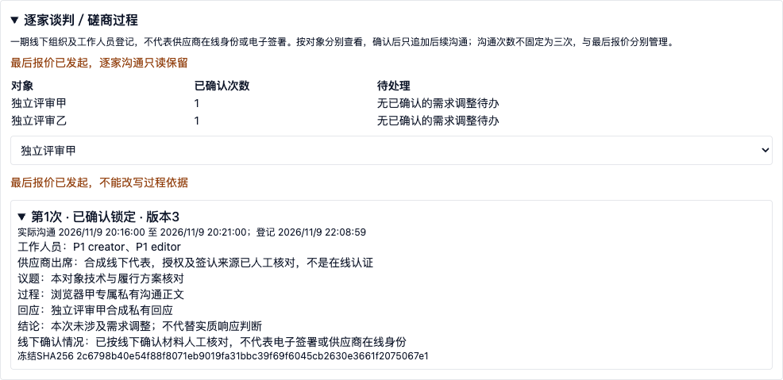
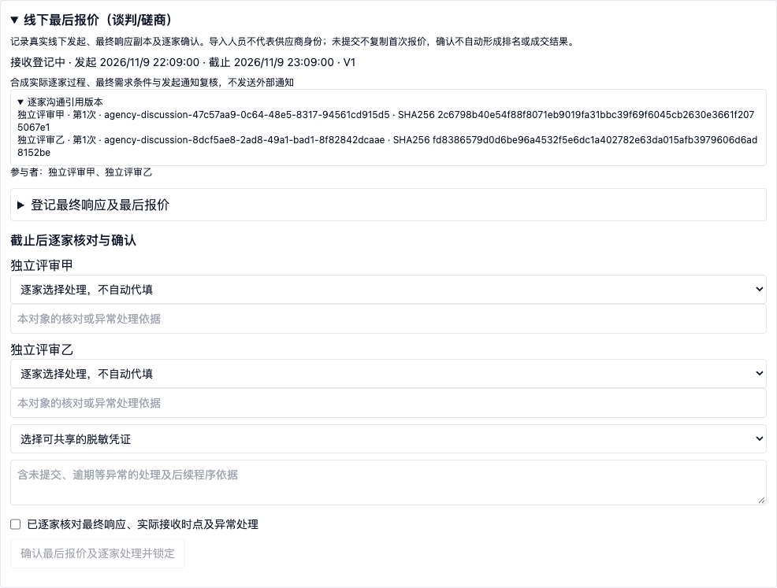

# P3逐家谈判／磋商过程交付说明

交付日期：2026年11月9日。P3第9项已在24Bid隔离工作区实现并验证；未部署生产。一期采用组织工作人员登记线下过程的方式；全流程电子标继续放在第二期，对接现有产品或重新开发尚未决定，详见[阶段边界](../../../docs/p0/04_实施计划.md)。

## 本次完成

新建竞争性谈判、竞争性磋商评审任务必须显式启用逐家沟通过程，冻结当前评审对象、开启依据及版本。已有历史任务由V282明确标记为历史线下路径，不补造沟通记录；最后报价发起前可主动启用，启用后不能退回历史路径。其他采购方式不开放此功能。

每个供应商独立保存草稿和历次确认记录。草稿允许不完整，切换对象前须保存或显式放弃；冲突时保留本地内容，并由用户明确重新绑定当前版本。确认需要实际起止时间、冻结职责成员、供应商出席说明、议题、过程、回应、结论、封存材料，以及线下确认来源和人工核对。材料引用使用项目内已封存的脱敏版本，校验实际字节和哈希；本轮没有新增私密原始材料柜。

确认后形成不可变快照，保留对象、工作人员姓名职责、前次记录哈希、材料哈希和确认操作者。后续只能追加沟通；未确认草稿可作废并保留原文。沟通次数不固定为三次；技术上限为每对象100条、每任务1000条。已确认事实不提供直接改写；需更正或需求调整时进入后续授权流程或重新组织，不以覆盖历史代替。

查看和维护同时校验项目数据范围、权限点和本轮冻结组织职责。普通独立评审成员即使有广泛权限也不能查看组织者私有沟通。汇总进度、通用事件及最后报价引用不复制私有过程和供应商回应；逐家切换不带入其他对象内容。本轮是人工线下登记，不代表供应商在线身份认证、电子签署或实际发送通知。

## 与最后报价及异常控制衔接

所有未处理草稿及已确认的“需要授权需求变更”标记都会阻断最后报价。排除供应商、追加一条“无变更”记录或填写说明均不能解除变更阻断；授权变更确认及同步通知凭证将在下一项开发，本轮没有伪造审批通过状态。

发起最后报价时核对全过程指纹、选中对象的最新确认记录及实际沟通时间，发起时间不得早于相关沟通结束。成功后封存准确的对象、记录ID、次序和哈希，逐家过程转为只读。轮次暂停阻断保存、确认及作废；恢复必须单独办理，恢复后旧指纹仍不能用于确认。历史最后报价保留显式历史路径和空引用；价格依据兼容旧记录结构，避免新增空字段使原有有效价格快照失效。

## 验证与证据

| 项目 | 结果 |
| --- | --- |
| 后端全量 | 1331项通过，失败、错误、跳过均为0 |
| 前端全量 | 184个文件、855项通过 |
| 最终专项 | 后端87项、前端6项通过；兼容性与只读展示微调后完成 |
| 生产构建 | TypeScript及Vite通过 |
| 实际HTTP | 7组通过，含连续4次确认、不可变记录、草稿冲突、越权、变更阻断、暂停恢复和历史价格兼容 |
| 浏览器 | 5组通过，页面异常0；含草稿续写、逐家隔离、精确引用封存和普通评审人隔离 |
| 前项回归 | 材料开启14、独立评审15、评审准备14、基础9、初次报价7、最后报价9、价格10、汇总7、异常9组通过 |
| 数据库和契约 | 隔离库V282成功；OpenAPI共8项操作、7个路径、28个Schema |

全量测试后进行了兼容性和只读展示微调，并执行上述最终专项及最终构建。真实HTTP和浏览器采用合成磋商场景，谈判共享方式校验与过程规则；不将这些结果等同于六种方式、真实项目或生产容量验收。实际采购文件样例、Office实际模板往返验收继续保留为后续门槛。

[验收汇总](evidence/p3-discussion-validation-summary.json)、[后端日志](evidence/p3-discussion-backend-tests.log)、[前端日志](evidence/p3-discussion-frontend-tests.log)、[最终后端专项](evidence/p3-discussion-final-targeted-backend.log)、[最终前端专项](evidence/p3-discussion-final-targeted-ui.log)、[构建](evidence/p3-discussion-build.log)、[HTTP结果](evidence/p3-discussion-http.json)、[浏览器结果](evidence/p3-discussion-browser.json)、[回归链](evidence/p3-discussion-regression-chain.log)、[迁移](evidence/p3-discussion-migration.json)。





## 代码与复验

[数据库迁移](../../backend-java/src/main/resources/db/migration/V282__agency_supplier_discussions.sql)、[过程服务](../../backend-java/src/main/java/com/procurement/agency/application/AgencyDiscussionService.java)、[规则](../../backend-java/src/main/java/com/procurement/agency/application/AgencyDiscussionPolicy.java)、[前端面板](../../apps/tenant-portal/src/features/agency/agency-discussion-panel.tsx)、[接口契约](p3-discussion-openapi.json)。新增权限为`buyer:agency:evaluation:discussion:read`和`buyer:agency:evaluation:discussion:manage`。

在implementation目录、隔离服务及合成租户就绪后，按顺序执行：

```sh
python3 scripts/p3-incident-run-smoke.py
node scripts/p3-discussion-smoke.mjs
node scripts/p3-discussion-browser.mjs
```

脚本使用本地`.p0`登录会话，不能用于生产。历史迁移兼容检查另依赖迁移前保留的私有合成会话`.p0/p3-discussion-legacy-session.json`；不能通过API制造历史豁免。会话和运行密钥不属于交付证据，不入库。重跑基础链生成新合成租户，避免历史累计触发轮次技术上限；不要删除业务历史绕过限制。

下一项：P3第10项，授权需求变更确认与同步线下通知凭证。之后继续六方式专有程序、推荐及报告；当前不宣称P3整体完成。
